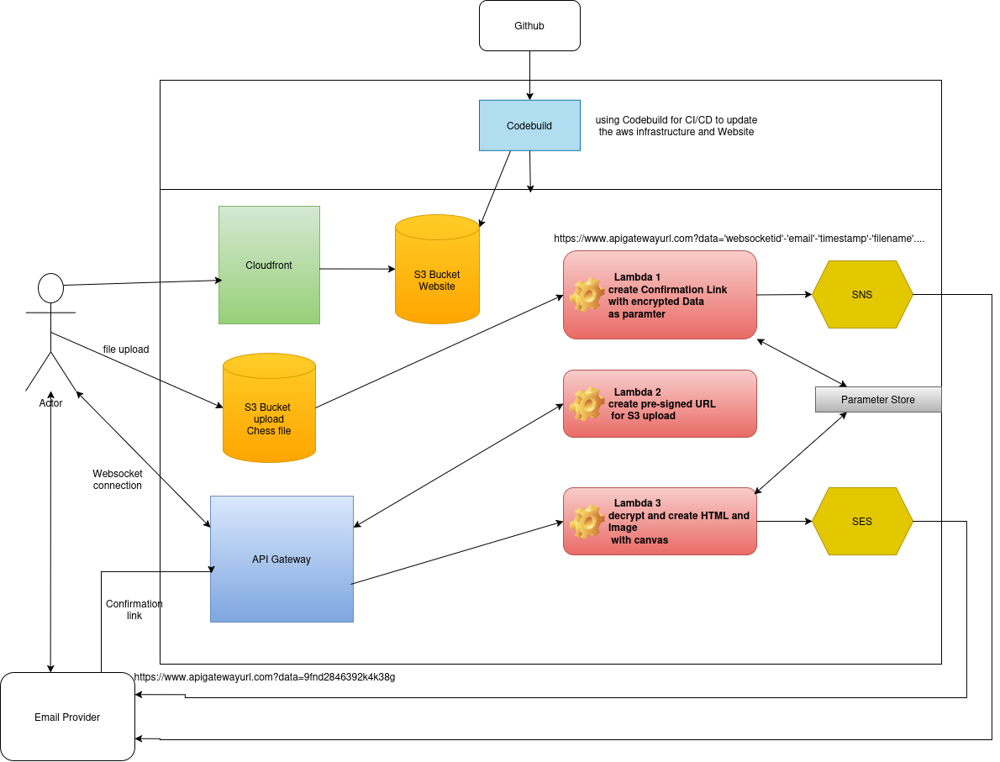

# Checkmate Replay Hub

A chess platform designed to automate the processing and evaluation of recorded chess games.

## 📌 About the Project

**Checkmate Replay Hub** is a specialized platform that streamlines post-tournament workflows. Players upload a simplified move file along with their email address. 

To ensure data integrity and prevent spam, the platform uses a **double opt-in email verification process**:
1. **Verification:** Players receive a confirmation link via email after uploading. The submission is only processed *after* this link is clicked.
2. **Delivery:** Once the processing is complete, a second email delivers the final results directly to the user.

### 🚀 Key Benefits
* **Automation:** Eliminates repetitive post-tournament tasks.
* **Validation & Calculation:** Automates file validation, final position calculation, game results, and move counts.
* **Clean Interface:** The web interface deliberately focuses strictly on displaying the real-time processing status, keeping clutter to a minimum.

---

## ⚙️ Processing Workflow

The web interface is dedicated solely to tracking the submission status. The final calculated positions and game results are **delivered exclusively via email**.

### Submission States

| Phase | Status | Description |
| :--- | :--- | :--- |
| **Before Confirmation** | `UPLOADING` | The game file is currently being uploaded. |
| | `AWAITING_CONFIRMATION` | Confirmation email sent. The recipient must click the verification link. |
| | `ERROR` | The upload failed. The user can retry the upload. |
| **After Link Click** | `PROCESSING` | The submission is being validated and evaluated asynchronously. |
| | `DONE` | Processing completed successfully. The results email has been sent. |
| | `FAILED` | Processing failed. An error notification email has been sent. |

  

